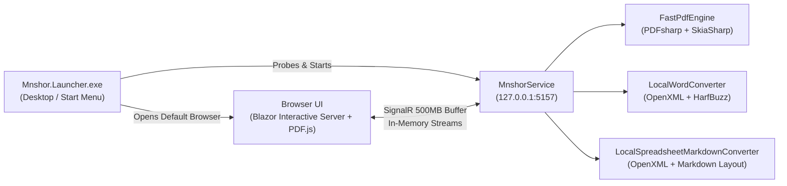

<div align="center">


# Mnshor — مَنشُور

**High-Speed, 100% Local-First & In-Memory PDF and Document Processing Suite**

[](https://github.com/amdnaji/mnshor/actions/workflows/ci.yml)
[](https://github.com/amdnaji/mnshor/releases)
[](#)
[](LICENSE)
[](https://dotnet.microsoft.com/)
[](#getting-started)
[](#why-mnshor)

**[English](README.md)** · **[العربية (Arabic)](README.ar.md)**

</div>

---

## Overview

**Mnshor (مَنشُور)** is a fast, privacy-first PDF and document processing suite engineered to run **100% locally on your machine**. Every document operation—merging, splitting, rotating, watermarking, stripping metadata, or converting Word (`.docx`), Excel (`.xlsx`), and Markdown (`.md`) files to PDF—executes **entirely in RAM (`MemoryStream`)** with **zero cloud uploads** and **zero temporary disk writes**.

On Windows, Mnshor can run either as a lightweight background Windows Service (`MnshorService` bound strictly to `http://127.0.0.1:5157`) paired with an instant desktop launcher (`Mnshor.Launcher.exe`), or directly as a self-hosted .NET 11 web application.

---

## Why Mnshor?

- **100% In-Memory & Zero Disk I/O**: Sensitive legal, financial, and enterprise documents never leave your device and are never written to temporary folders on disk.
- **First-Class Arabic (RTL) & Complex Script Shaping**: Built with `SkiaSharp.HarfBuzz` and custom system font/emoji resolvers (`SystemFontResolver`, `EmojiRenderer`) for connected Arabic ligatures, bidirectional (RTL/LTR) layout flow, and color/monochrome vector symbols.
- **Bilingual Experience (Arabic & English)**: Instant one-click switch between Arabic (`RTL`) and English (`LTR`) interfaces, plus Dark and Light themes.
- **Built for Large Documents**: Paginated thumbnail views, jump-to-page navigation, and batch range controls designed to handle 100+ page PDFs smoothly.
- **Execution Telemetry**: Every operation reports exact in-memory execution time in milliseconds (`ms`).

---

## Included Tools & Capabilities

| Tool | Description | Key Features |
| :--- | :--- | :--- |
| **1. Merge PDF** | Combine multiple PDF files into a single document in memory. | Drag-and-drop multi-file upload, visual reordering, page count badges, instant merged output. |
| **2. Split & Extract PDF** | Extract custom page ranges or burst a PDF into individual pages. | Custom range syntax (e.g., `1-3, 5, 8-10`) or **Burst Mode** (packages every page as an individual PDF inside an in-memory `.zip` archive). |
| **3. Rotate PDF Pages** | Rotate all or specific PDF pages by `90° CW`, `90° CCW`, or `180°`. | Live page thumbnail previews, individual page rotation, odd/even/custom range batch rotation, 100+ page pagination. |
| **4. Remove PDF Pages** | Delete unwanted pages visually or by range expression. | Click-to-remove visual cards, select odd/even/invert, safeguard preventing empty documents. |
| **5. Reorder & Reverse PDF** | Rearrange page sequence visually or via custom order syntax. | Move first/last/up/down, jump-to-position, one-click **Reverse Order (`N..1`)**, or custom sequence (`3, 1, 2, 4-6`). |
| **6. Metadata & Privacy Sanitizer** | Inspect, edit, or completely strip hidden PDF metadata. | Edit `Title`, `Author`, `Subject`, `Keywords`, `Creator`, `Producer`, or use **One-Click Privacy Sanitizer** to wipe all hidden properties and XMP streams. |
| **7. Watermark PDF** | Stamp text or image logos across PDF pages with live preview. | Text & image watermarks, Arabic shaping, 9-grid positioning, **Mosaic Tiling**, opacity, custom rotation, Over/Below content layer, page range targeting. |
| **8. Word, Excel & Markdown to PDF** | Convert `.docx`, `.xlsx`, and `.md` files into print-ready PDFs in RAM. | **Word (`.docx`)**: Headings, tables, lists, inline styling, images, RTL/LTR.<br>**Excel (`.xlsx`)**: Multi-sheet selector, live preview, Landscape/Portrait, A4/A3/Letter, RTL/LTR column flow, repeating headers, zebra striping, gridlines.<br>**Markdown (`.md`) Studio**: Live editor with English & Arabic sample templates, tables, code blocks, blockquotes, and auto-direction. |
| **9. Sign PDF Document** | Sign and stamp PDFs interactively in memory with OS fonts, freehand drawing, or image stamps. | **Type (OS Fonts)** with Arabic & English script fonts and flourish underline, **Draw Freehand** canvas, **Upload Image/Stamp** with ink tinting, interactive drag/drop/resize for **Signature**, **Date**, and **Official Stamp** fields, high-DPI preview up to 500 MB. |

---

## Architecture



### Repository Structure

```text
mnshor/
├── Mnshor.sln                                # Solution file (.NET 11)
├── src/
│   ├── Mnshor/                               # Main Blazor Interactive Server & Windows Service host
│   │   ├── Components/Pages/                 # 8 interactive document tool pages
│   │   ├── Engines/                          # In-memory PDF, Word, Excel, Markdown, Font & Emoji engines
│   │   ├── Models/                           # Options, metadata, and execution result models
│   │   ├── Services/                         # Bilingual (AR/EN) localization & state management
│   │   └── wwwroot/                          # Prism CSS theme, PDF.js worker, client interop
│   └── Mnshor.Launcher/                      # Native Windows tray/desktop launcher executable
├── installer/
│   ├── build-msi.ps1                         # Automated test + publish + WiX MSI build script
│   └── Mnshor.Installer/                     # WiX v4+ installer definition (Package.wxs & Assets)
└── tests/
    └── Mnshor.Tests/                         # xUnit test suite covering all processing engines
```

---

## Getting Started

### Prerequisites

- **[.NET 11.0 SDK](https://dotnet.microsoft.com/download/dotnet/11.0)** (required to build and run from source)
- **[WiX Toolset v4+](https://wixtoolset.org/)** (optional — only required if building the `.msi` Windows installer)

### 1. Clone & Run in Development Mode

```powershell
git clone https://github.com/amdnaji/mnshor.git
cd mnshor

dotnet run --project src/Mnshor/Mnshor.csproj
```

Then open **`http://localhost:5157`** in your browser.

### 2. Run the Automated Unit Tests

Mnshor includes a comprehensive `xUnit` suite validating PDF merging, splitting, rotation, page removal, reordering, metadata sanitization, text/image watermarking, Word (`.docx`) conversion, Excel (`.xlsx`) table pagination, and Markdown (`.md`) rendering:

```powershell
dotnet test Mnshor.sln -c Release
```

### 3. Build the Windows MSI Installer

To package a self-contained `win-x64` Windows Service installer (`.msi`):

```powershell
# Install WiX CLI & UI extension once if not already installed:
dotnet tool install --global wix
wix extension add -g WixToolset.UI.wixext

# Build the MSI package into ./dist/
.\installer\build-msi.ps1 -Version 0.2.0 -Stage alpha
```

---

## Special Thanks & Open-Source Acknowledgments

**Mnshor** stands on the shoulders of extraordinary open-source projects. We extend our sincere gratitude to the authors, maintainers, and communities behind the libraries that make 100% local, in-memory document processing possible:

| Project | Role in Mnshor | License |
| :--- | :--- | :--- |
| **[.NET 11 & ASP.NET Core Blazor](https://github.com/dotnet/aspnetcore)** | High-performance runtime, Interactive Server UI components, and Windows Service hosting (`Microsoft.Extensions.Hosting.WindowsServices`). | [MIT](https://github.com/dotnet/aspnetcore/blob/main/LICENSE.txt) |
| **[PDFsharp](https://github.com/empira/PDFsharp)** | Core in-memory PDF document reading, page assembly, splitting, rotation, metadata sanitization, and vector drawing. | [MIT](https://github.com/empira/PDFsharp/blob/master/LICENSE) |
| **[SkiaSharp](https://github.com/mono/SkiaSharp) & [HarfBuzz](https://github.com/harfbuzz/harfbuzz)** | 2D graphics rendering, image watermark compositing, and complex Arabic (`RTL`) text shaping (`SkiaSharp.HarfBuzz`). | [MIT](https://github.com/mono/SkiaSharp/blob/main/LICENSE.md) |
| **[Open-XML-SDK (`DocumentFormat.OpenXml`)](https://github.com/dotnet/Open-XML-SDK)** | Native in-memory parsing of Microsoft Word (`.docx`) documents and Excel (`.xlsx`) workbooks without requiring Office installation. | [MIT](https://github.com/dotnet/Open-XML-SDK/blob/main/LICENSE) |
| **[Mozilla PDF.js](https://github.com/mozilla/pdf.js)** | Fast client-side PDF page thumbnail previews inside the browser. | [Apache-2.0](https://github.com/mozilla/pdf.js/blob/master/LICENSE) |
| **[WiX Toolset](https://github.com/wixtoolset/wix)** | Packaging Mnshor and `MnshorService` into a clean Windows `.msi` installer. | [MS-RL](https://wixtoolset.org/about/license/) |
| **[xUnit.net](https://github.com/xunit/xunit) & [Coverlet](https://github.com/coverlet-coverage/coverlet)** | Automated unit testing and code coverage verification for all document engines. | [Apache-2.0](https://github.com/xunit/xunit/blob/main/LICENSE) / [MIT](https://github.com/coverlet-coverage/coverlet/blob/master/LICENSE) |
| **[IBM Plex Sans Arabic](https://github.com/IBM/plex) & [Plus Jakarta Sans](https://github.com/tokotype/PlusJakartaSans)** | Crisp, modern open-source typography for our Arabic and English user interfaces. | [OFL-1.1](https://openfontlicense.org/) |

---

## Contributing

Contributions, bug reports, and feature requests are welcome!

1. Fork the repository.
2. Create a feature branch (`git checkout -b feat/your-feature`).
3. Ensure all unit tests pass (`dotnet test Mnshor.sln -c Release`).
4. Commit your changes and open a Pull Request.

---

## License

This project is open-source software licensed under the **[MIT License](LICENSE)**.
